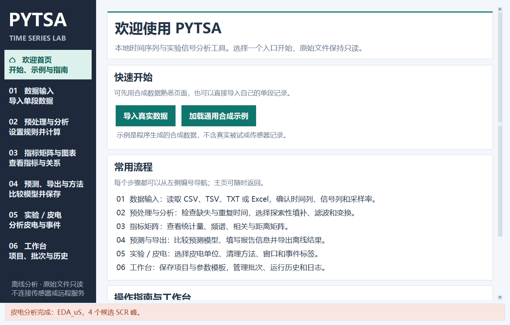
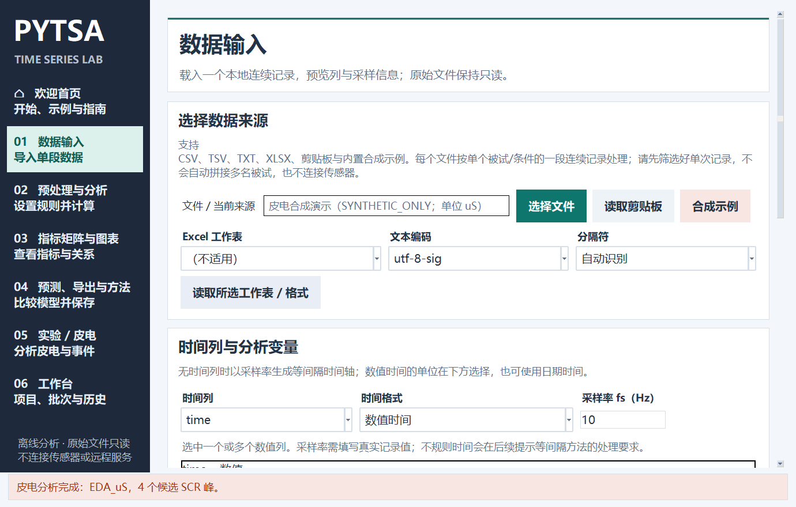
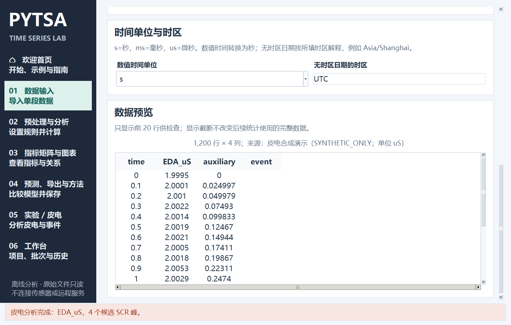
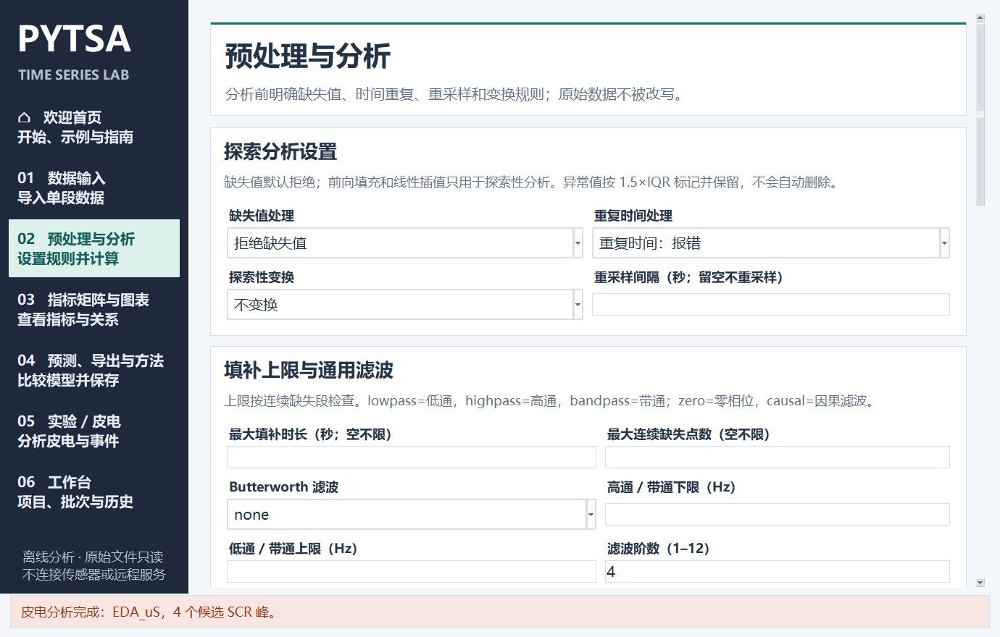
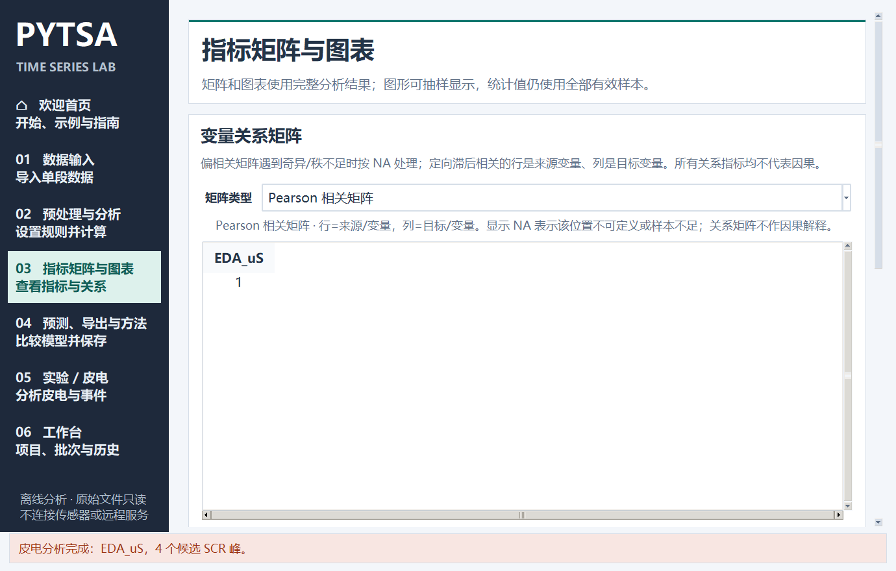
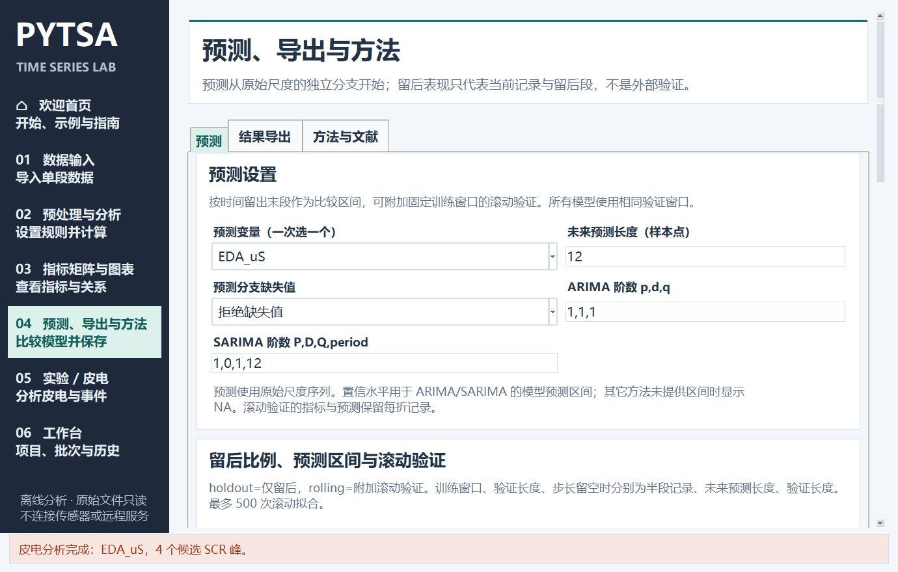
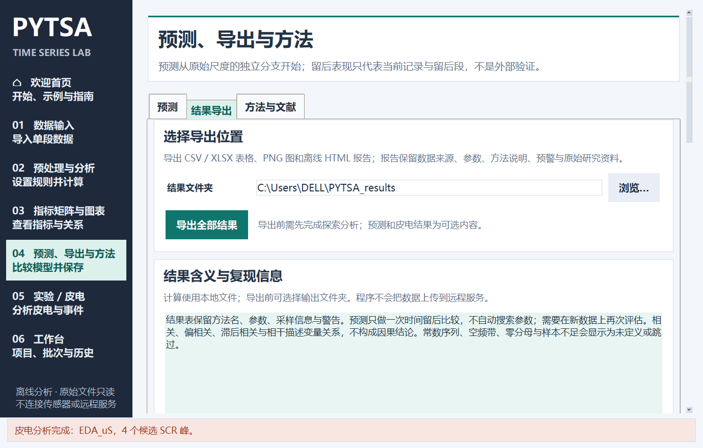
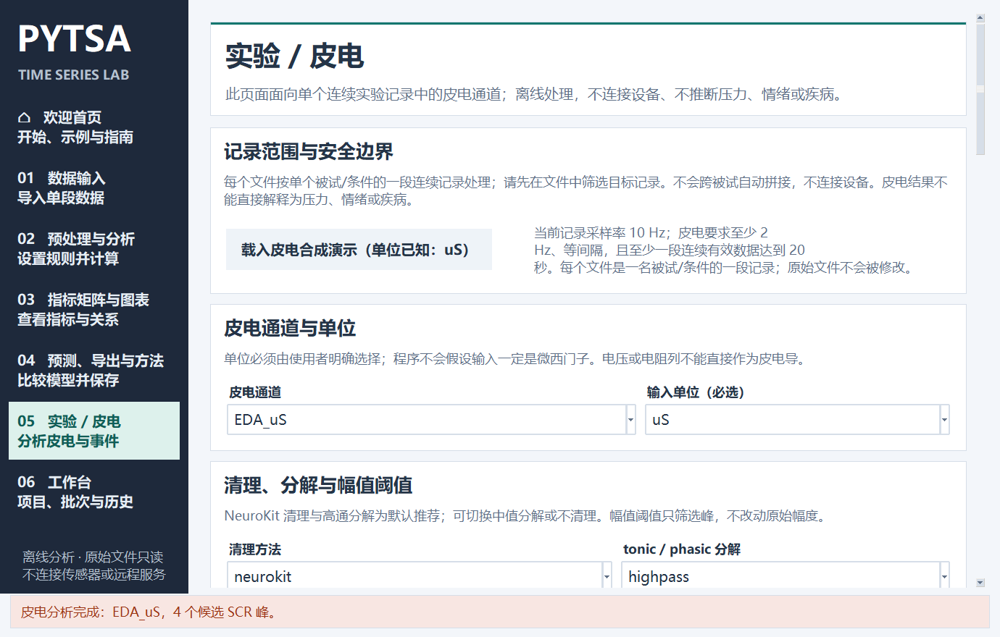
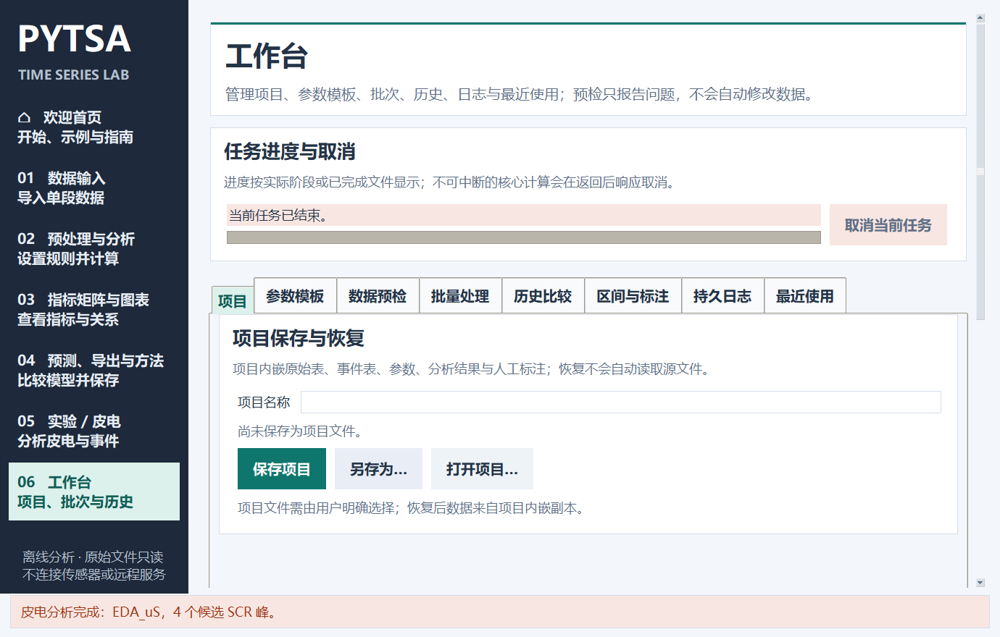

# PYTSA 操作指南

适用于 PYTSA 1.3.1。本文按日常使用顺序说明桌面程序的入口、主要流程和结果保存方式。程序在本机读取表格并分析，原始输入文件保持只读。

## 快速演示

1. 启动 PYTSA 后会先看到加载画面，初始化完成后进入欢迎首页。
2. 点击首页的 **加载通用合成示例**。程序会载入明确标记为 `SYNTHETIC_ONLY` 的时间序列，并转到“数据输入”预览。
3. 左侧进入 **02 预处理与分析**，保留默认设置并点击 **准备数据并分析**。
4. 查看 **03 指标矩阵与图表**、**04 预测、导出与方法**。要练习皮电流程，可在 **05 实验 / 皮电** 点击皮电合成演示按钮。
5. 点击左侧 **欢迎首页** 可随时返回入口。

合成示例由程序生成，只用于熟悉界面和查看流程，不是真实被试、实验或传感器数据，不能用于实证结论。通用时间序列示例与皮电示例是两组不同数据。载入任一示例后再导入文件，新文件会替换当前记录和派生结果。

## 导入真实数据、设置时间与采样率

在 **01 数据输入** 点击 **选择文件**，选择 CSV、TSV、TXT 或 XLSX。文本读取失败时，检查“文本编码”和“分隔符”；Excel 文件可先选择工作表，再点 **读取所选工作表 / 格式**。也可以读取剪贴板中的表格文本。

载入后在“时间列与分析变量”中选择时间列和一个或多个数值信号列。无时间列时，程序会按采样率生成等间隔时间轴。请填写真实的 **采样率 fs（Hz）**；不能确定采样率时，先查数据采集设备或文件说明，不要把记录行数当作采样率。

数值时间可以选择秒 `s`、毫秒 `ms` 或微秒 `us`；日期时间可在“时间单位与时区”里检查时区。无时区日期按指定时区解释，有时区值会转换到 UTC。重复或不存在的夏令时本地时刻需要用带偏移的时间明确表示。加载后先看预览中的列名、首尾时间和单位是否与原数据一致。

每个文件按**一个被试或条件的一段连续记录**处理。程序不会自动拼接多名被试，也不会连接采集设备。若文件包含多个被试，请先按研究设计拆分或筛选记录。

## 预处理与分析

进入 **02 预处理与分析**。先根据数据情况设置：

- **缺失值处理**：默认拒绝。前向填充和线性插值只用于探索性分析；可同时设置最大缺失时长或连续缺失点数上限。
- **重复时间处理**：可报错、取均值或保留首条。选择应符合记录含义。
- **重采样间隔**：只有在需要统一等间隔时间轴且已确认目标间隔时才填写，单位为秒。
- **探索性变换与滤波**：去趋势、Hampel 去尖峰、中值或 Savitzky–Golay 平滑、陷波、小波软阈值和 Butterworth 滤波均为可选项，默认关闭；这些操作改变探索分支。预测仍使用保留的原始尺度分支。
- **指标参数**：ACF/PACF 滞后、周期、Welch 分段长度和频带等应与采样率和记录长度相容。

点击 **准备数据并分析**。结果包含描述统计、平稳性和残差检验、异常值标记及结构图。异常值按规则标记但不会自动删除。若计算被拒绝，先阅读弹出的原因和页面状态，再决定是否修正输入或参数。

## 指标矩阵与图表

完成分析后进入 **03 指标矩阵与图表**，从矩阵类型中选择 Pearson、Spearman、Kendall τ、协方差、偏相关、指定滞后相关、频带平均平方相干或标准化欧式距离。Kendall 矩阵描述秩相关，不计算显著性 p 值。图表标签可切换时域、ACF/PACF、Welch PSD 与 STL 分解。

矩阵用于描述当前变量之间的统计关系；滞后相关的方向由界面说明，相关、偏相关与相干本身都不代表因果。样本不足、常数序列或空频带可能显示 NA 或提示。

## 预测与导出报告

在 **04 预测、导出与方法** 的“预测”标签中选择预测变量、未来长度、留后比例和模型。建议先使用简单模型作为基线，再按记录长度选择 ETS、ARIMA 或 SARIMA；季节周期按样本点填写。留后比较仅表示当前记录中的时间留后表现，不等同于独立外部验证。

预测完成后切换到“结果导出”标签：

1. 填写或浏览选择结果文件夹。
2. 选择报告模板、标题、实验信息、章节和输出格式。
3. 需要时选择要导出的图表；确认预测、皮电等可选结果是否已经生成。
4. 点击 **导出全部结果**，等待状态栏提示完成，再打开生成的时间戳目录。

可选格式包括 CSV、XLSX、JSON、PNG 和离线 HTML。HTML 报告可单独打开；选中 CSV/XLSX 时也会输出相应数据表。导出前可在工作区保存或复用报告模板。

## 实验与皮电

进入 **05 实验 / 皮电**。可以使用当前已载入记录，也可点击 **载入皮电合成演示（单位已知：uS）** 熟悉皮电设置。选择皮电数值列和输入单位，确认采样率；此流程要求至少 2 Hz、等间隔，并至少有一段连续有效数据达到 20 秒。

按实验设计选择清理与分解方法、检测阈值、固定窗口长度和统计区间。没有事件表时可不设置事件；需要事件统计时可载入事件表，或从原始连续标签列提取事件。事件表时间使用从记录起点开始的秒数。运行后检查原始、清理、tonic/phasic 曲线和结果表。皮电分析结果不直接推断压力、情绪或疾病。

## 工作台、项目、模板、批次与历史

在 **06 工作台** 的标签中管理本地项目和任务：

- **项目**：首次使用“另存为…”创建 `.pytsa.json` 项目；后续可保存当前项目。项目会嵌入当前表格、参数和可用结果，打开项目不会自动重新读取原始路径。源文件移动后，到数据输入页重新选择并载入新位置，再完成分析和保存。
- **参数模板**：在“参数模板”保存预处理、分析、预测、皮电及事件设置。应用模板只会更新界面，不会自动开始计算；引用了不存在的列时需按提示映射。
- **批量处理**：添加一个或多个数据文件，明确选择事件文件策略；有事件文件时不要依赖文件名自动配对。按需指定输出目录后开始批次，完成和失败项会分别记录。
- **历史比较**：每次成功运行会保存快照。选择两条历史记录比较参数、指标和可用曲线；只有定义和单位相容时才会计算差值或叠加曲线。
- **最近使用、日志、区间与标注**：用于查找本机记录、排查任务错误和保存人工区间说明。标注不会自动改变分析样本。

## 配置与环境

进入 **07 配置与环境** 可以导入或导出完整参数、设置运行后端与 CPU 并行数，并检测可选依赖。配置文件包含预处理、分析、预测、皮电、事件映射和运行资源设置，不包含数据文件。导入后请核对列名、采样率、单位和事件时间。

- `cpu` 使用 CPU；`auto` 在 GPU 可用时尝试使用，否则记录原因并回到 CPU；`gpu` 要求 GPU 功能检测通过，否则报错。GPU 目前只加速 Pearson、协方差和标准化距离矩阵，其它检验、预测及皮电求解使用 CPU。
- “检测环境”会尝试导入依赖，并执行 CuPy 求和与矩阵乘法来确认 GPU 是否可用。安装 Python 组件不会安装显卡或驱动。GPU 需有兼容的 NVIDIA GPU、驱动和对应 CuPy 版本。
- “一键安装缺少包”只安装软件支持的可选组件。源码运行时装入当前 Python；便携 EXE 的可选组件使用独立环境，需要匹配 EXE 的 CPython 主次版本。安装后重启程序并重新检测。该过程需要网络。
- cvxEDA 分解需要可选依赖 `cvxopt`。BioSPPy 清理要求采样率高于 10 Hz；SparseEDA 是实验性方法，可能失败。NeuroKit 的 cvxEDA 接口不公开求解器收敛状态，输出有限数值不能单独证明优化已收敛。

并行线程数范围为 1–32，速度提升取决于数据大小和操作类型。更多线程不一定更快。实际使用效果以环境检测结果、页面状态和运行提示为准。

## 常见问题

**启动后看不到主窗口怎么办？** 程序会先显示加载画面，再进入欢迎首页。若窗口初始化失败，会显示异常类型和实际错误内容。记录完整错误文本后，再检查运行环境或资源文件。

**文件读入后时间或频谱不合理？** 核对时间列、数值时间单位、时区和 `fs`。频率分析要求采样信息正确；不规则采样不能仅靠填写一个 `fs` 修正。

**为什么某些操作提示先完成分析？** 预测、矩阵结果和导出需要当前数据已载入，并完成预处理与分析。皮电页面还需要选择有效通道、单位和采样设置。

**项目提示源文件 changed 或 missing？** 项目里的嵌入表格和保存结果仍可恢复。需要换成新路径时请重新选择数据文件；程序不会自动寻找或替换源文件。

**导出的 HTML 中没有表格下载链接？** 表格链接取决于导出时是否选择 CSV 或 XLSX；只选择 HTML 时图表会嵌入报告，但不会额外生成完整表格文件。

**在哪里找到本机模板与历史？** Windows 默认工作区位于 `%LOCALAPPDATA%\PYTSA`；设置 `PYTSA_HOME` 可指定独立位置。启动后，模板、历史、日志和批次记录均留在本机工作区。
